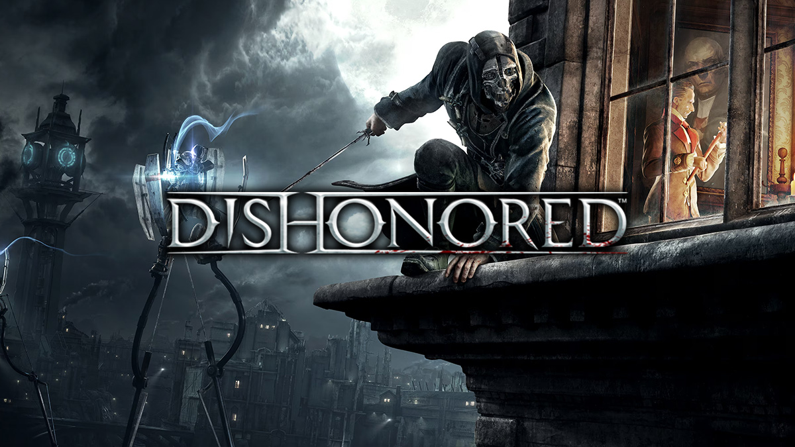

  

# dishonored-nx

A Nintendo Switch port of **Dishonored** (Xbox 360, 2012) by static recompilation with
[ReXGlue](https://github.com/rexglue), drawn through Renut's Direct3D-level renderer on deko3d.

**No game files are included.** You need your own legally obtained copy of Dishonored **EU** (Xbox 360). This repository
holds only the port's source code; the recompiled code (`generated/`) and the shader packages (`switch_shaders/`) are
made from your copy of the game on your machine.

## Status (0.20)

- Playable: 480p internal resolution, FSR-style upscale to the screen, the handheld 460.8 MHz GPU profile requested
  automatically (the official one; the memory clock is left alone).
- For 30 fps gameplay, **Overclock is highly recommended** (measured on CPU@1785 MHz, RAM@1700 MHz). At stock clocks (1020 MHz) the game runs at 20 fps and
  the sound can crackle in busy fights: the game's CPU work is the limit.
- Using 4 CPU cores is **recommended** (launched through a Sphaira forwarder, see below).

## Installing (players)

1. Copy `dishonored.nro` from the release to `sdmc:/switch/dishonored-nx/`.
2. Copy your extracted game (the folder with `default.xex`, `DishonoredGame`, `Engine`, ...) to
   `sdmc:/switch/dishonored-nx/game_root/`.
3. Start it from the homebrew menu opened **through a game** (hold R while starting a game), not from the album: the
   album gives homebrew too little memory.
4. Optional, for four cores: create a forwarder of `dishonored.nro` with Sphaira ("Install Forwarder") and start the
   game from it twice. On the first start the game writes `sdmc:/atmosphere/contents/<forwarder id>/exefs/main.npdm`
   (an NPDM that grants core 3); it never writes one for a retail title's id.

The first start compiles a few shaders (short pauses); they are cached in `sdmc:/switch/dishonored-nx/`.

## Settings

`sdmc:/switch/dishonored-nx/dishonored.toml` is written next to `dishonored.nro` on the first start, with every
setting described and commented out. To change one, remove the `#` in front of it and edit the value; put the `#` back
(or delete the file) for the default. Changes take effect at the next start.

| Key | Default | |
|---|---|---|
| **Graphics** | | |
| `dishonored_fsr` | `true` | FSR-style edge-adaptive upscale with sharpening (~1-2 ms GPU a frame); `false` = plain bilinear |
| `dishonored_fsr_sharpness` | `0.3` | sharpening of the upscale, 0.0 (none) to 2.0 (strong) |
| `dishonored_render_height_handheld` | `480` | internal render height: 480, 720, 1080, 1440 or 2160; 480 is the tested one |
| `dishonored_render_height_docked` | `480` | the same, docked |
| **Performance** | | |
| `dishonored_gpu_boost` | `true` | handheld: the official 460.8 MHz GPU profile (memory clock untouched); `false` = stock 307.2 MHz |
| `hot_thread_cores` | `1` | the busiest game thread gets its own core: 0 off, 1 recommended (2 starves the sound) |
| **Sound** | | |
| `audio_switch_frames_in_queue` | `20` | sound buffered ahead, 5.3 ms frames (20 = 107 ms): higher = fewer crackles, more delay |
| **Controls** | | |
| `input_xbox_layout` | `true` | face buttons by position (Xbox layout); `false` = by letter |
| `input_joycon_sideways` | `true` | single Joy-Cons held sideways; `false` = upright |
| `[input_p1]` `a` ... `right` | `""` | button remap per Xbox button: a list of Switch buttons (`A B X Y L R ZL ZR PLUS MINUS LSTICK RSTICK UP DOWN LEFT RIGHT SL SR`) or `NONE`, e.g. `a = "B, ZR"` |
| **Log** | | |
| `log_level` | `"warning"` | `"error"`, `"warning"`, `"info"` (detailed, for bug reports) or `"debug"` |
| `log_to_file` | `true` | write the log to `logs/` next to `dishonored.nro` |

## Building (Windows)

Needs devkitPro (Switch development: devkitA64, libnx, deko3d, switch-tools, switch-zlib, switch-zstd), Visual
Studio's CMake and Ninja, LLVM 20 (the PC build that runs the generator), Python 3 and Git. Everything else is in this
repository: the SDK fork is `tools/rexglue-sdk-dishonored` (from sa2-nx through pure-nx).

1. `python tools\rexglue-sdk-dishonored\tools\fetch_thirdparty.py` - the SDK's third-party sources.
2. DXC: copy `bin\` and `lib\` of a DirectXShaderCompiler release (Windows zip,
   github.com/microsoft/DirectXShaderCompiler/releases) into
   `tools\rexglue-sdk-dishonored\app\thirdparty\reblue-XenosRecomp\thirdparty\dxc-bin\`.
3. Your game in `assets\game_root\` (`assets\game_root\default.xex`).
4. `build.cmd` once (the SDK, the generator, `generated\default`), then `build_switch_turbo.cmd nopgo` (the optimised
   codegen and an LTO build: `out\nx-lto\dishonored.nro`). The release build adds PGO: `build_switch_pgo.cmd`.
5. `switch_shaders\` - the shader package made from your copy of the game's shaders (not included).
6. `package_switch.cmd [drive]` - the SD card folder.

## License

GPL-3.0 (`LICENSE`), as the sa2-nx / banjo-nx code it is built on. Third-party parts keep their licenses
(`tools/rexglue-sdk-dishonored/THIRD_PARTY_NOTICES.md`). Dishonored is a trademark of its owners; this project is not
affiliated with or endorsed by them.
