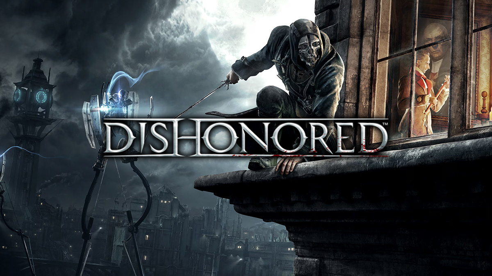

<p align="center">
  
</p>

# dishonored-nx

A Nintendo Switch port of **Dishonored** (Xbox 360, 2012) by static recompilation with
[ReXGlue](https://github.com/rexglue), drawn through Renut's Direct3D-level renderer on deko3d.

**No game files are included.** You need your own legally obtained copy of Dishonored **EU** (Xbox 360). This repository
holds only the port's source code; the recompiled code (`generated/`) and the shader packages (`switch_shaders/`) are
made from your copy of the game on your machine.

## Status (0.50)

- Playable: 480p internal resolution (540p optional), upscaled to the screen with sharpening, clean sound, the
  handheld 460.8 MHz GPU profile requested automatically (the official one; the memory clock is left alone).
- For stable 30 fps gameplay, **Overclock is highly recommended** (measured on CPU@1428 MHz, RAM@1600 MHz). At stock clocks (1020 MHz) the game runs at 24-ish fps. Performance work is ongoing.
- Using 4 CPU cores is **required** (launched through a Sphaira forwarder, see below).

## Installing (players)

1. Copy `dishonored.nro` from the release to `sdmc:/switch/dishonored-nx/`.
2. Copy your extracted game (the folder with `default.xex`, `DishonoredGame`, `Engine`, ...) to
   `sdmc:/switch/dishonored-nx/game_root/`.
3. Start it from the homebrew menu opened **through a game** (hold R while starting a game), not from the album: the
   album gives homebrew too little memory.
4. Required, for four cores: create a forwarder of `dishonored.nro` with Sphaira ("Install Forwarder") and start the
   game from it twice. On the first start the game writes `sdmc:/atmosphere/contents/<forwarder id>/exefs/main.npdm`
   (an NPDM that grants core 3); it never writes one for a retail title's id.

The first start compiles a few shaders (short pauses); they are cached in `sdmc:/switch/dishonored-nx/`.

**Updating:** replace `dishonored.nro` and **delete your old `dishonored.toml`** first. The `.nro` never replaces an
existing one, and an old file keeps outdated settings; a fresh one is written at the next start.

## Settings

`sdmc:/switch/dishonored-nx/dishonored.toml` is written next to `dishonored.nro` on the first start, with every
setting described and its default shown (a line starting with `#` is the default, already active). To change one,
remove the `#` in front of it and edit the value; put the `#` back (or delete the file) for the default. Changes take
effect at the next start.

| Key | Default | |
|---|---|---|
| **Graphics** | | |
| `dishonored_render_height_handheld` | `480` | internal render height: `480` (853x480, steadiest), `540` (960x540, sharper, a little more GPU), `720` and up not recommended |
| `dishonored_render_height_docked` | `480` | the same, docked |
| `dishonored_fsr` | `true` | upscale with contrast-adaptive sharpening (~1 ms GPU a frame); `false` = plain bilinear (softer) |
| `dishonored_fsr_sharpness` | `0.3` | sharpening of the upscale, 0.0 (none) to 2.0 (strong) |
| `dishonored_fsr_full` | `false` | the full edge-adaptive FSR-style upscale instead: slightly sharper edges, ~6 ms GPU a frame; not recommended |
| **Performance** | | |
| `dishonored_renut_occlusion_queries` | `true` | objects hidden behind walls are not drawn; `false` if models pop in late or vanish (costs GPU time) |
| `dishonored_gpu_boost` | `true` | handheld: the official 460.8 MHz GPU profile (memory clock untouched); `false` = stock 307.2 MHz |
| `hot_thread_cores` | `1` | the busiest game thread gets its own core: `0` off, `1` recommended; `2` can freeze the game at the startup movies |
| **Sound** | | |
| `audio_switch_frames_in_queue` | `24` | sound buffered ahead, 5.3 ms frames (24 = 128 ms): higher = fewer crackles, more delay |
| **Controls** | | |
| `input_xbox_layout` | `true` | face buttons by position (Xbox layout); `false` = by letter |
| `input_gyro` | `false` | gyro aiming on from the start (see below) |
| `input_gyro_sensitivity` | `1.0` | gyro speed, 0.1 to 5.0; try 1.5-2.0 for faster turning |
| `input_gyro_invert_x` / `input_gyro_invert_y` | `false` | swap left/right or up/down of the gyro |
| `[input_p1]` `a` ... `right` | `""` | button remap per Xbox button: a list of Switch buttons (`A B X Y L R ZL ZR PLUS MINUS LSTICK RSTICK UP DOWN LEFT RIGHT SL SR`) or `NONE`, e.g. `a = "B, ZR"` |
| **Log** | | |
| `log_level` | `"warning"` | `"error"`, `"warning"`, `"info"` (detailed, for bug reports) or `"debug"` |
| `log_to_file` | `true` | write the log to `logs/` next to `dishonored.nro` |

**Gyro aiming:** while playing, press `L` + `R` and click the right stick at the same time to turn it on or off. Turn
and tilt the console (handheld), the Pro Controller or the right Joy-Con to move the camera on top of the right stick:
the stick for big turns, the gyro for fine aiming.

## Change language

The EU version has several languages built in; the game uses the console language the port reports. To change it,
add this line to `dishonored.toml` (next to `dishonored.nro`) and restart the game:

```toml
user_language = 4
```

| Value | Language |
|---|---|
| `1` | English (default) |
| `3` | German |
| `4` | French |
| `5` | Spanish |
| `6` | Italian |
| `9` | Portuguese |
| `11` | Polish |
| `12` | Russian |

Only languages present in your copy of the game work; any other value falls back to English.

## Reporting bugs and crashes

Send the newest `logs/dishonored_XXX.log` (next to `dishonored.nro`) and, after a crash, the file with the same time
from `/atmosphere/crash_reports/` (or `/atmosphere/fatal_reports/`), with a short note on what you were doing. On a GPU
fault the log lists the last draws the GPU was given.

## Building (Windows)

Needs devkitPro (Switch development: devkitA64, libnx, deko3d, switch-tools, switch-zlib, switch-zstd), Visual
Studio's CMake and Ninja, LLVM 20 (the PC build that runs the generator), Python 3 and Git. Everything else is in this
repository: the SDK fork is `tools/rexglue-sdk-dishonored` (from sa2-nx through pure-nx).

1. `python tools\rexglue-sdk-dishonored\tools\fetch_thirdparty.py` - the SDK's third-party sources.
2. DXC: copy `bin\` and `lib\` of a DirectXShaderCompiler release (Windows zip,
   github.com/microsoft/DirectXShaderCompiler/releases) into
   `tools\rexglue-sdk-dishonored\app\thirdparty\reblue-XenosRecomp\thirdparty\dxc-bin\`.
3. Your game in `assets\game_root\` (`assets\game_root\default.xex`).
4. `build.cmd` once (the SDK, the generator, `generated\default`), then `build_switch_turbo.cmd nopgo` (the optimised
   codegen and an LTO build: `out\nx-lto\dishonored.nro`). The release build adds PGO: `build_switch_pgo.cmd`.
5. `switch_shaders\` - the shader package made from your copy of the game's shaders (not included).
6. `package_switch.cmd [drive]` - the SD card folder.

## License

GPL-3.0 (`LICENSE`), as the sa2-nx / banjo-nx code it is built on. Third-party parts keep their licenses
(`tools/rexglue-sdk-dishonored/THIRD_PARTY_NOTICES.md`). Dishonored is a trademark of its owners; this project is not
affiliated with or endorsed by them.
